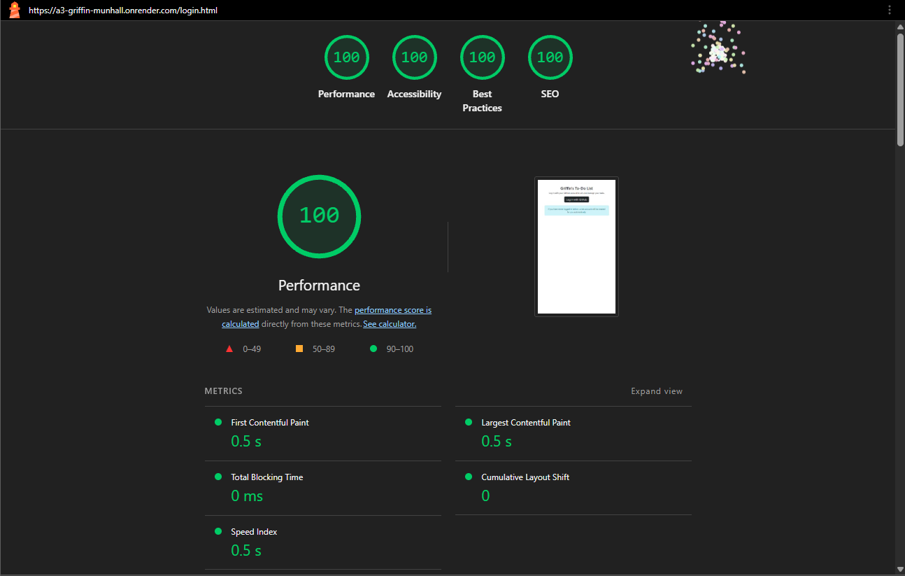
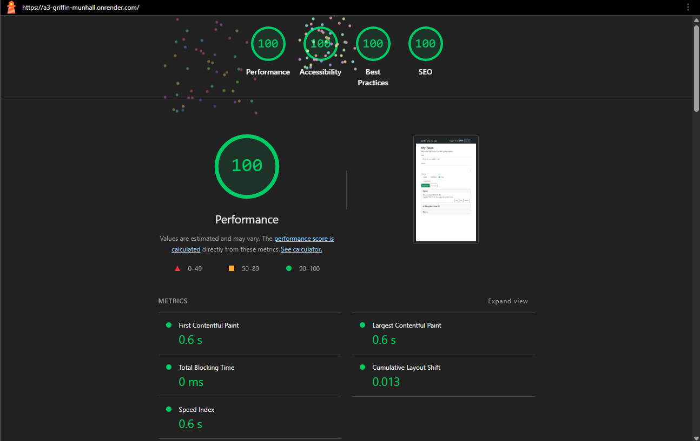

## Griffin's To-Do List

Live site: [https://a3-griffin-munhall.onrender.com](https://a3-griffin-munhall.onrender.com)

For A3, I took my A2 code, which created a very simple to-do list web app that allows tasks to be created and moved between three lists: an open list for new tasks, an in-progress task list that only allows a maximum of three items, and a done list for finished tasks. You add a new task with a name and priority, and the server will compute a derived deadline based on the input priority. Buttons on the tasks allow you to move them between lists, edit the task, and delete it. My goal for A3 was to turn the shared single array of tasks that lived in memory on the server into a multi-user platform where everything is stored and separated in a database.

I did run into some challenges in doing this, however. First, converting the plain HTTP module into Express routes, although cleaner, required a reorder so the / route checks the logged-in status before serving index.html. Second, adding the ability for users to edit more than one field was challenging. In A2, editing was completed through a window.prompt that only changed the task text, but since tasks now have notes, priorities, and a flag for importance, I needed to find a different way. I ended up reusing the add form section for editing, so when edit is clicked, the form is filled in with the task info and the button to save is changed to Save Changes. The last major challenge for me was setting up OAuth. Beyond the obvious technical implementation difficulties, getting it working with different URIs between Render and localhost was difficult. I ended up adding both URIs in my GitHub OAuth app and putting the callback URL, client ID, client secret, MongoDB connection string, and session secret in a .env.

For the authentication strategy, I used GitHub OAuth through Passport and the passport-github2 strategy. I picked it because the assignment asks for GitHub if you use OAuth, and all the graders have GitHub accounts. It also meant that I didn't have to store or hash passwords myself, and it seemed to be the most straightforward option because Passport handles the GitHub redirect and token exchange itself.

For CSS, I used Bootstrap. I picked it because I remember using it in CS 3733, and I found that its documentation was easy to follow. It also really had everything that I needed to work with like navbar, cards for the lists, lists groups, form controls, etc. I removed my custom styling from A2 and let Bootstrap do all the work, so I didn't write any custom CSS.

## Technical Achievements

- OAuth with GitHub (10 Pts): Users log in with GitHub. I used Passport to complete this, with /auth/github sending users to GitHub and /auth/github/callback where GitHub sends them back. In the strategy's verification, I look up the username in MongoDB and create a new user document if one isn't present. I also pass back a flag to let the app know that a message should be displayed telling the user that an account has been made for them. I added redirection to /login.html if you aren't logged in, and any data route includes a checkLogin that returns a 401 if you aren't. There's also a /logout route. The hardest part for me was figuring out the infrastructure surrounding the implementation, like configuring GitHub's OAuth app settings and the callback URLs on localhost vs. Render. The issue here was largely that if anything is wrong, it just fails without a clear indication of why.

- 100% in 4 Lighthouse test (5 pts): Got 100 on both the login and main page. To get to 100, I added `<meta name="description">` to both pages for SEO. I also loaded main.js with defer and got rid of the Google Font from A2. I gave every form field a label, wrapped radio buttons in a fieldset a legend, and used Bootstrap colors with ample contrast. I used an empty favicon so the browser doesn't show a 404 for /favicon.ico, and I added compression so responses are gzipped.

- Express Middleware Packages (5 pts): I used the following five:
    - Helmet: Sets a group of HTTP response headers that protect apps from common attacks.
    - Compression: Compresses response bodies so JS, CSS, and JSON load quicker.
    - Morgan: Logs HTTP requests to console, which aided in debugging.
    - Express-Session: Gives site visitors a session tracked with a cookie, so the app remembers who is logged in.
    - Passport: Auth middleware that runs the GitHub OAuth login and puts the logged-in user on req.user for each request.