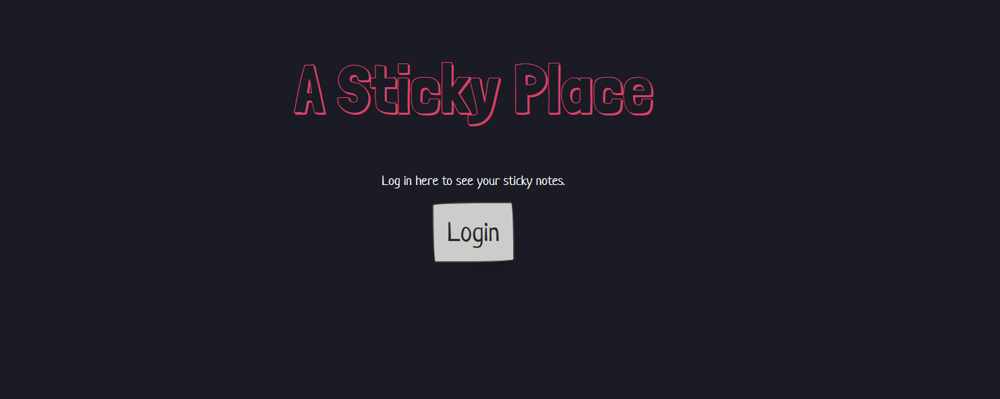
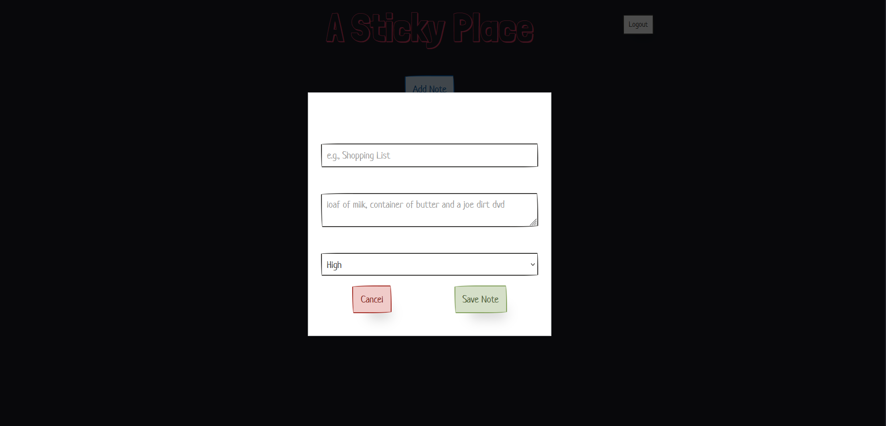
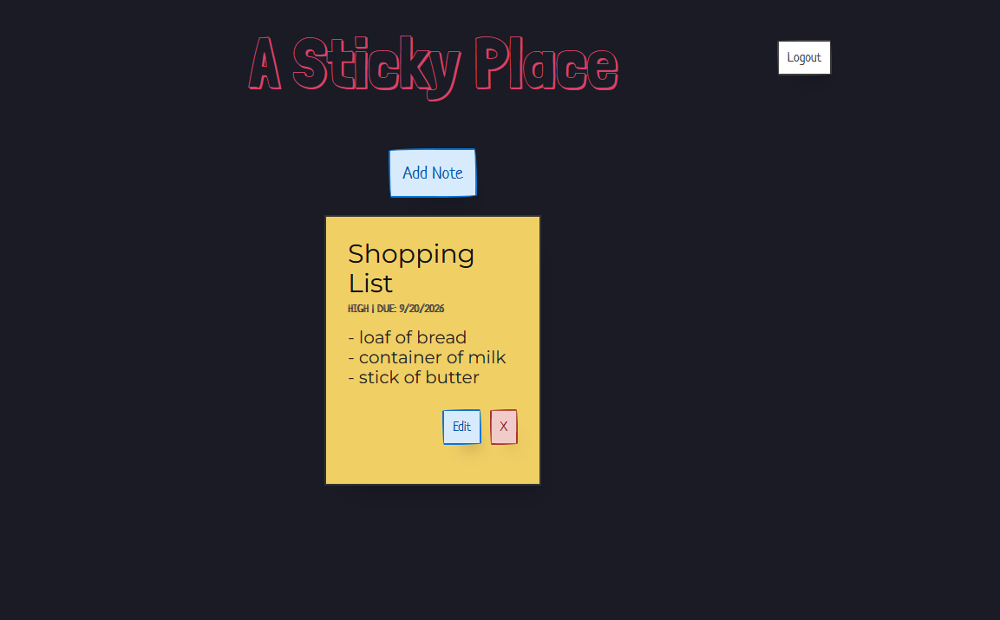
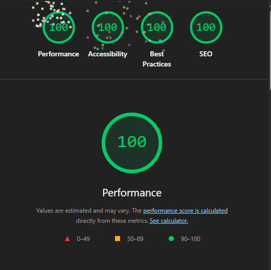

Assignment 3 - Persistence: Two-tier Web Application with Database, Express server, and CSS template

## A Sticky Place

https://a3-abhi-chillara.onrender.com/app.html

- application was made as a way to have a sticky note fridge type interface
- lighthouse tests were hard to figure out and there were hard parts trying to integrate authentication
- oAuth using github
- i used the paper css framework because the feel felt correct for it and also since sticky notes are paper it felt a little poetic

## Technical Achievements
- **Tech Achievement 1**: I used OAuth authentication via the GitHub strategy
- **Tech Achievement 2**: I got 100 on all 4 lighthouse tests
- **Tech Achievement 3**: I used 5 middleware packages in the website.
  - Helmet: Sets secure http headers to protect app from vulnerabilities.
  - Morgan: Prints out every http request to console
  - Compression: speeds up load times by compressing json and html files.
  - Cookie Parser: Looks at incoming cookie headers and populates req.cookies.
  - Express Limiter: Prevents server from getting overloaded with requestions in a short period of time.

### Design/Evaluation Achievements
- **Design Achievement 1**: I followed the following tips from the W3C Web Accessibility Initiative
  1. Unique and informative titles
  2. Headings have meaning and structure. Headings also don't skip between numbers
  3. Links are not ambiguous and the login says login through github
  4. Landing page has clear instructions
  5. There is contrast between colours. Light text against dark background and dark text against the sticky note background
  6. Information is conveyed through words and not just color. Like urgency is explicitly shown
  7. Interactive elements have hover animations and clearly stand out.
  8. There is clear confirmation of typing out a sticky note and feedback is clear.
  9. every label is clear
  10. Markup has meaning and structure
  11. Page language is identified in html as english.
  12. Added code make website warp to user's device

