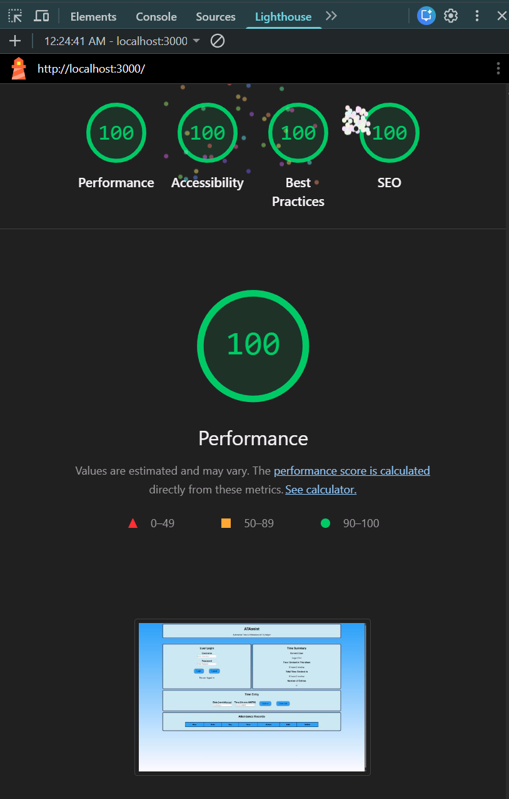

Assignment 3 - Persistence: Two-tier Web Application with Database, Express server, and CSS template
===

## ATAssist - https://a3-noahfreeman.onrender.com/

ATAssist is a tool to help log your time on the clock. Sick of Automated Time & Attendance (ATA) being confusing? Use this thing. In order to use the app, you must login with a username in the upper left box, you can use a new name or an existing one. Then input the date and time and click the 'clock in' or 'clock out' buttons to log the time event. A user is able to login by entering a correct username and password pair. If an unclaimed username is entered with a password, a new user will be created. I implemented basic password authentication for simplicity. When logged in, user statistics will display in the upper right, and all time entries for your user will appear at the bottom of the screen. When a user is logged in, you can edit or delete that user's time entries my clicking the corresponding button in the table, editing  or deleting the values, and clicking confirm. I used tailwind css stylesheet for this assignment. I included custom css for maintaining desired colors, sizes, and specifying th egrid template areas.

## Technical Achievements
- **Tech Achievement 1**: The site achieves a 100 on all categories of the lighthouse audit

